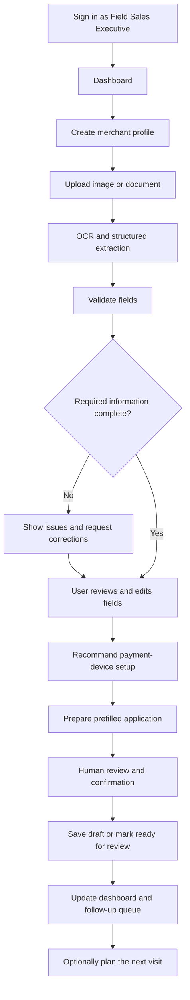

# NEXA

> **An AI-powered field sales co-pilot that streamlines merchant profiling, document extraction, payment-device recommendations, and onboarding from a single workspace.**

**Project type:** Hackathon prototype  
**Status:** In development  
**Primary users:** Field Sales Executives (FSEs), Area Sales Managers, and optional administrators

---

## Table of Contents

- [Overview](#overview)
- [Problem Statement](#problem-statement)
- [Proposed Solution](#proposed-solution)
- [Goals and Success Criteria](#goals-and-success-criteria)
- [Core Workflow](#core-workflow)
- [Features and Priorities](#features-and-priorities)
- [User Roles](#user-roles)
- [System Architecture](#system-architecture)
- [Technology Stack](#technology-stack)
- [Repository Structure](#repository-structure)
- [Getting Started](#getting-started)
- [Environment Configuration](#environment-configuration)
- [Application Workflow and Statuses](#application-workflow-and-statuses)
- [Database Design](#database-design)
- [API Design](#api-design)
- [AI, OCR, and Recommendation Design](#ai-ocr-and-recommendation-design)
- [Security and Privacy](#security-and-privacy)
- [Testing Checklist](#testing-checklist)
- [Demo Walkthrough](#demo-walkthrough)
- [Roadmap](#roadmap)
- [Team Responsibilities](#team-responsibilities)
- [Limitations and Assumptions](#limitations-and-assumptions)
- [Contributing](#contributing)
- [License](#license)

---

## Overview

**NEXA** is a proposed AI-assisted workspace for field sales teams. It is designed to reduce repetitive work involved in collecting merchant information, reading documents, checking profile completeness, selecting suitable payment devices, and preparing onboarding applications.

Rather than functioning as a generic chatbot or a static CRM, the product guides a sales executive through a structured and reviewable workflow. AI assists with unstructured information and explanations, deterministic rules validate data and determine readiness, and the application records changes and workflow status.

> **Project note:** This repository describes a hackathon prototype concept. It is not an official Paytm product or a representation of Paytm's internal architecture. Features and integrations should be described as implemented only after they have been built and tested.

## Problem Statement

Field Sales Executives may need to collect merchant details, inspect documents, select payment devices, complete forms, and plan follow-up visits across multiple steps and tools. Manual handling can contribute to:

- Incomplete merchant profiles.
- Repeated data entry and avoidable errors.
- Missing or inconsistent information discovered late in onboarding.
- Unclear reasons behind a suggested payment-device setup.
- Difficulty tracking drafts, pending reviews, and follow-ups.

## Proposed Solution

The application brings the key steps into one workflow:

1. **Capture:** Create a merchant profile manually or upload a supporting image/document.
2. **Extract:** Use OCR and an AI model to convert readable information into structured fields.
3. **Validate:** Apply deterministic checks to flag missing, malformed, or conflicting values.
4. **Recommend:** Suggest an eligible payment-device setup from a clearly defined catalogue and explain why it fits the merchant's stated needs.
5. **Prepare:** Prefill an editable onboarding application from the reviewed profile.
6. **Review:** Let the sales executive confirm and correct details before the application can be marked ready.
7. **Track:** Persist merchant records, application status, follow-ups, and optional visit-planning information.

## Goals and Success Criteria

The prototype is intended to demonstrate that a prepared merchant case can be processed end to end without manual database intervention.

| Area | Prototype success criterion |
|---|---|
| Profile creation | Complete a prepared demo case in under two minutes. |
| Extraction | Extract supported fields from sample documents and make uncertainty visible. |
| Validation | Detect missing fields, malformed values, and inconsistencies. |
| Recommendations | Provide a consistent suggestion with understandable reasons and an alternative where applicable. |
| Application preparation | Create a prefilled, editable application for human review. |
| Persistence | Save and retrieve merchant records and changes. |
| Demo reliability | Complete the core workflow without direct database edits. |

These are **prototype targets**, not measured performance results or verified business outcomes.

## Core Workflow



The sales executive remains responsible for reviewing extracted details, correcting issues, and confirming the application.

## Features and Priorities

### P0 — Core workflow

These features should be implemented and tested first.

- Merchant registration and manual data entry.
- Image/document upload with file validation.
- OCR and structured AI extraction.
- Field-level status, evidence, and uncertainty where the provider supports them.
- Validation of required fields, formats, and conflicting values.
- Payment-device recommendations based on a sample catalogue and deterministic rules.
- Recommendation reasons and alternatives.
- Prefilled, editable onboarding application.
- Draft saving, database persistence, and status tracking.
- Manual-entry fallback if extraction fails.

### P1 — High-value sales tools

Add after the core workflow is stable.

- Dashboard with metrics calculated from stored records.
- Merchant directory with search, filters, and profile status.
- Follow-up queue and prospect management.
- Suggested visit order using sample locations.
- Recent activity and incomplete-application summaries.

### P2 — Optional extensions

These depend on time, access, provider credentials, and quotas.

- Live maps and road travel-time calculations.
- Multilingual voice input.
- Expanded manager analytics.
- Authorized integrations with official merchant-management or device-catalogue systems.

A reliable end-to-end onboarding workflow is the priority over disconnected advanced features.

## User Roles

| Role | Responsibilities |
|---|---|
| Field Sales Executive (FSE) | Create merchant profiles, review extracted information, correct fields, inspect recommendations, prepare applications, and plan visits. |
| Area Sales Manager | Monitor onboarding progress, incomplete applications, follow-ups, and team activity. |
| Administrator (optional) | Manage sample device catalogues, validation rules, user access, and demo settings. |

Role-based access should be enforced by the backend and database policies, not only by hiding frontend controls.

## System Architecture

```text
React + Vite Frontend
  ├── Dashboard
  ├── Merchant Directory
  ├── Merchant Profiler
  ├── Device Recommendation
  ├── Application Review
  └── Prospect / Route Planner
             |
             v
Node.js + Express API
  ├── Authentication and authorization
  ├── Request validation
  ├── Workflow orchestration
  ├── Merchant and document APIs
  ├── Validation and recommendation services
  └── Provider adapters
       |          |           |
       v          v           v
    OCR / LLM   Rule Engine  Supabase
                             ├── PostgreSQL
                             ├── Auth
                             └── Private Storage
       |
       v
Optional Maps Provider / Mock Route Planner
```

### Architectural principles

- Keep provider integrations behind backend adapters so providers can be replaced without rewriting the frontend.
- Use AI for unstructured information and explanations; use deterministic code for required fields, formats, eligibility, and readiness checks.
- Validate AI responses against a schema before using them.
- Require human review before an application is marked ready.
- Treat uploaded documents and OCR output as untrusted input.
- Support a recoverable draft and manual entry if an external provider is unavailable.

## Technology Stack

The following is the **proposed stack** from the execution plan. Adjust this section to match the technologies actually present in the repository.

| Layer | Proposed technology | Purpose |
|---|---|---|
| Frontend | React, Vite, TypeScript, Tailwind CSS | Dashboard, merchant forms, recommendations, review screens, and route planner. |
| Backend | Node.js, Express, TypeScript | API endpoints, validation, workflow orchestration, and provider integrations. |
| Database | Supabase / PostgreSQL | Persistent merchant, document, recommendation, application, and visit records. |
| Authentication | Supabase Auth | Sign-in and user identity. |
| File storage | Supabase Storage with a private bucket | Store uploaded sample documents securely. |
| OCR | Google Cloud Vision or another available OCR provider | Recognize text in images/documents. |
| LLM | Gemini API or another approved model | Normalize OCR text into structured fields and explain recommendations. |
| Mapping | Google Maps Platform or a mock route planner | Optional distance and visit-order suggestions. |
| Deployment | Vercel for the frontend and a Node-compatible backend host | Deploy the web application and API. |

## Repository Structure

Suggested monorepo layout:

```text
nexa/
├── client/
│   ├── src/
│   │   ├── components/
│   │   ├── pages/
│   │   │   ├── Dashboard.tsx
│   │   │   ├── MerchantList.tsx
│   │   │   ├── MerchantProfiler.tsx
│   │   │   ├── Recommendation.tsx
│   │   │   ├── ApplicationReview.tsx
│   │   │   └── RoutePlanner.tsx
│   │   ├── services/
│   │   ├── hooks/
│   │   └── types/
│   └── package.json
├── server/
│   ├── src/
│   │   ├── routes/
│   │   ├── controllers/
│   │   ├── services/
│   │   │   ├── ocr.service.ts
│   │   │   ├── extraction.service.ts
│   │   │   ├── validation.service.ts
│   │   │   ├── recommendation.service.ts
│   │   │   └── routing.service.ts
│   │   ├── adapters/
│   │   ├── middleware/
│   │   └── app.ts
│   └── package.json
├── supabase/
│   └── migrations/
├── .env.example
├── .gitignore
├── package.json
└── README.md
```

The actual directory structure may differ as implementation evolves.

## Getting Started

### Prerequisites

Install or prepare the following, depending on the components implemented:

- Node.js (a current LTS release is recommended).
- npm.
- A Supabase project for persistent storage and authentication.
- API credentials for the selected OCR and LLM providers, if live integrations are enabled.
- A mapping provider key only if live maps are implemented.

### 1. Clone the repository

```bash
git clone <repository-url>
cd nexa
```

Replace `<repository-url>` with the repository's actual clone URL.

### 2. Install dependencies

For a monorepo with a root workspace:

```bash
npm install
```

If the frontend and backend use independent package files instead:

```bash
cd client
npm install

cd ../server
npm install
```

Use the installation method that matches the repository's actual `package.json` files.

### 3. Configure environment variables

Create local environment files from `.env.example` if one is provided. See [Environment Configuration](#environment-configuration) for the proposed variables.

### 4. Configure Supabase

If Supabase is enabled:

1. Create the required PostgreSQL tables and relationships.
2. Apply the project's SQL migrations.
3. Enable Row Level Security (RLS) on tables containing user or merchant data.
4. Configure policies to restrict users to records they are authorized to access.
5. Create a private storage bucket for uploaded documents.
6. Configure authentication providers and redirect URLs for the deployed environments.

Do not use production merchant data for local testing or the hackathon demo.

### 5. Run the application

The exact commands depend on the scripts defined in the repository. A common workspace setup may provide:

```bash
npm run dev
```

For separate packages, the frontend and backend may each expose their own development script:

```bash
cd client
npm run dev
```

```bash
cd server
npm run dev
```

Check each package's `scripts` section and use the commands actually defined there. The commands above are examples, not a guarantee that the current repository is configured this way.

## Environment Configuration

A proposed `.env.example` may include the following placeholders. **Only retain variables used by the implementation.**

```dotenv
# Frontend
VITE_API_BASE_URL=http://localhost:3000/api
VITE_SUPABASE_URL=
VITE_SUPABASE_ANON_KEY=

# Backend
PORT=3000
NODE_ENV=development
CLIENT_ORIGIN=http://localhost:5173

# Supabase server configuration
SUPABASE_URL=
SUPABASE_SERVICE_ROLE_KEY=

# AI / OCR providers — server-side only
GEMINI_API_KEY=
GOOGLE_CLOUD_VISION_CREDENTIALS=

# Optional maps integration — server-side only
GOOGLE_MAPS_API_KEY=
```

### Environment variable rules

- Never commit `.env` files or credentials.
- Never expose a Supabase service-role key, LLM key, OCR credential, or privileged maps key through frontend variables.
- Frontend variables prefixed with `VITE_` are generally exposed to browser code. Only put values there that are safe to expose.
- Keep `.env.example` populated with blank placeholders, not working secrets.
- Use separate credentials and configuration for development and deployment.

## Application Workflow and Statuses

Suggested merchant/application states:

```text
new → extracting → needs_review → ready_for_submission → submitted
```

Optional states:

- `extraction_failed`
- `rejected`

A record may move to `needs_review` when fields are missing, extraction is uncertain, or source values conflict. It should move to `ready_for_submission` only after the required checks pass and a human confirms the information.

In the prototype, **`submitted` must mean a simulated in-app status unless an authorized official integration actually submits the application**. Do not imply that Paytm has approved or received an application when that has not happened.

## Database Design

The proposed PostgreSQL model contains these core entities:

| Table | Example fields | Purpose |
|---|---|---|
| `users` | `id`, `name`, `role` | Authenticated FSE and manager profiles. |
| `merchants` | `id`, `owner_id`, `business_name`, `business_type`, `phone`, `gstin`, `address`, `status`, timestamps | Main merchant profile and workflow state. |
| `documents` | `id`, `merchant_id`, `storage_path`, `document_type`, `extraction_status` | Uploaded file metadata and processing state. |
| `validation_issues` | `id`, `merchant_id`, `field_name`, `issue_code`, `status` | Missing, malformed, or inconsistent field tracking. |
| `recommendations` | `id`, `merchant_id`, `factors`, `result`, `ruleset_version` | Recommendation history and explainability. |
| `applications` | `id`, `merchant_id`, `status`, `form_data`, `updated_at` | Prefilled application and review state. |
| `visits` | `id`, `owner_id`, `merchant_id`, `scheduled_at`, `status` | Optional follow-up and route-planning records. |

Implementation recommendations:

- Use UUID primary keys, foreign keys, and `created_at` / `updated_at` timestamps.
- Index `owner_id`, `status`, and frequently searched fields.
- Enforce Row Level Security and verify ownership in backend endpoints.
- Keep sensitive information out of application logs and analytics.
- Use private document storage and short-lived signed URLs.
- If time is limited, defer separate `visits` and `validation_issues` tables and store a validation summary on the merchant record initially.

This is a proposed schema, not a claim that these tables already exist.

## API Design

Suggested REST API contract:

| Method | Endpoint | Purpose |
|---|---|---|
| `GET` | `/api/dashboard` | Fetch dashboard metrics. |
| `GET` | `/api/merchants` | List and filter merchant records. |
| `POST` | `/api/merchants` | Create a merchant profile. |
| `GET` | `/api/merchants/:id` | Retrieve merchant details. |
| `PATCH` | `/api/merchants/:id` | Update confirmed profile fields. |
| `POST` | `/api/merchants/:id/documents` | Register a document and initiate extraction. |
| `POST` | `/api/merchants/:id/validate` | Run validation rules. |
| `POST` | `/api/merchants/:id/recommend` | Generate a device recommendation. |
| `POST` | `/api/merchants/:id/application` | Create or update an onboarding draft. |
| `POST` | `/api/merchants/:id/mark-ready` | Mark a reviewed application ready. |
| `GET` | `/api/prospects` | Retrieve prospects for route planning. |
| `POST` | `/api/routes/optimize` | Suggest a visit order. |

All endpoints should authenticate the caller, validate request bodies, enforce authorization, and return consistent error responses. Never trust a merchant ID from the client without checking the caller's access.

### Example: Create a merchant

Request:

```json
{
  "businessName": "Sharma General Store",
  "businessType": "grocery",
  "gstin": null,
  "address": "Sample Market, Delhi"
}
```

Illustrative response:

```json
{
  "id": "generated-merchant-uuid",
  "status": "needs_review",
  "missingFields": ["gstin", "phone"],
  "message": "Profile created. Complete the required details."
}
```

The sample values are synthetic and are provided only to illustrate the proposed API shape.

## AI, OCR, and Recommendation Design

### OCR and structured extraction

The proposed extraction pipeline is:

1. Accept an image or document and validate its file type and size.
2. Run OCR through the configured provider.
3. Where practical, send only the text required for extraction to the LLM rather than unnecessary raw personal data.
4. Ask the model for schema-constrained structured output.
5. Validate the returned data on the backend.
6. Show extracted values and their evidence, uncertainty, or review state where supported.
7. Let the FSE correct any field before continuing.

Example conceptual field:

```json
{
  "business_name": {
    "value": "Sharma General Store",
    "evidence": "SHARMA GENERAL STORE",
    "status": "needs_review"
  },
  "gstin": {
    "value": null,
    "evidence": null,
    "status": "missing"
  }
}
```

This is an illustrative schema. A storefront image cannot reliably establish every business detail. The system must request missing information rather than invent it.

### Validation and verification

The system should distinguish between these concepts:

- **Format-valid:** A value matches an expected format or checksum rule.
- **Consistent:** The available supplied sources agree.
- **Verified:** An authorized, trustworthy source has confirmed the information.

Passing a regular expression or receiving an AI response does **not** constitute official verification.

Possible checks include:

- Required-field validation.
- Phone-number format validation.
- GSTIN format/checksum validation where supported.
- Address presence and user confirmation.
- Comparison of extracted and manually entered values.
- Authorized source lookup, only if an approved source is actually available.

### Payment-device recommendations

Use a deterministic rules engine to choose from an available catalogue. An LLM may explain the result, but it should not invent products, prices, or eligibility.

Potential inputs include:

- Merchant business category.
- Estimated payment frequency or volume, if provided.
- Whether audible payment confirmation is needed.
- Budget, if supplied.
- Products and eligibility in the configured sample catalogue.

Illustrative rules:

- If audible payment confirmation is required, consider an eligible Soundbox option.
- Otherwise, consider QR-based payment acceptance.
- If both visual and audible confirmation are requested, consider a QR + Soundbox bundle where the catalogue supports it.

Recommendations should include reasons, an alternative where possible, the inputs/rule version used, and a requirement for human confirmation. Use a clearly labelled sample catalogue until reliable product, pricing, and eligibility information is available.

## Security and Privacy

Security is part of the workflow, not a final polish step.

- Keep LLM, OCR, database service-role, and privileged mapping secrets on the backend.
- Require sign-in and enforce record ownership in both the API and database policies.
- Use private storage, file-size limits, MIME-type validation, and access-controlled URLs.
- Treat uploaded documents and OCR text as untrusted input; they must not override system instructions or trigger arbitrary tool calls.
- Validate AI output against a schema. If parsing fails, ask for correction or fall back to manual entry.
- Record relevant edits, recommendation rule versions, and status changes for auditability.
- If an OCR or AI provider fails, allow the user to save a recoverable draft and continue manually.
- Use synthetic data for demos and minimize collection of personal information.
- Do not collect Aadhaar, identity documents, or other sensitive data unless necessary, authorized, and appropriately protected.
- Confirm provider terms, costs, permissions, and data-handling requirements before enabling third-party services.

## Testing Checklist

Before a demo or release, verify the following:

- [ ] A valid merchant profile saves successfully.
- [ ] Missing GSTIN or phone information is flagged instead of invented.
- [ ] An unreadable image still allows manual entry.
- [ ] Malformed AI output does not crash the workflow.
- [ ] Recommendations include understandable reasons.
- [ ] An incomplete application cannot be marked ready.
- [ ] Edited fields persist after refresh.
- [ ] An FSE cannot access unauthorized records.
- [ ] OCR provider failure leaves a recoverable draft.
- [ ] Dashboard metrics match stored records or clearly labelled demo data.
- [ ] The route planner handles missing coordinates.
- [ ] The deployed demo works without local environment setup.
- [ ] No secrets are committed or exposed to the browser.

## Demo Walkthrough

A focused three-minute demonstration can follow this sequence:

1. **Introduce the problem:** Manual merchant data capture and onboarding can be repetitive and error-prone.
2. **Create a merchant:** Enter a sample merchant profile and upload a prepared shop image.
3. **Show extraction:** Display extracted fields and flag missing or inconsistent information.
4. **Correct data:** Update the fields requiring review.
5. **Show recommendation:** Present an explainable device suggestion based on the sample catalogue.
6. **Review application:** Inspect the prefilled form and save it as ready for review.
7. **Show tracking:** Return to the dashboard and show the updated status.
8. **Optional route planning:** Display a suggested next visit using synthetic locations.
9. **Explain future integrations:** Describe how official merchant-management, catalogue, or mapping integrations could connect if authorized access is provided.

Use synthetic data and clearly label simulated integrations throughout the demo.

## Roadmap

### Phase 1 — Foundation (0–4 hours)

- Set up the repository, React frontend, Express backend, Tailwind, and Supabase.
- Agree on API contracts.
- Build the initial dashboard structure.

### Phase 2 — Core data flow (4–12 hours)

- Build merchant creation, list/detail pages, and field validation.
- Add persistence and seeded demo data.

### Phase 3 — AI extraction (12–20 hours)

- Integrate OCR and structured extraction.
- Build field correction and warning states.
- Test sample images and failure handling.

### Phase 4 — Recommendations (20–28 hours)

- Implement deterministic recommendation rules.
- Add explanations, a prefilled application, and readiness checks.
- Store recommendation history.

### Phase 5 — Sales tools (28–36 hours)

- Calculate dashboard metrics from stored records.
- Add prospect filters, follow-ups, and sample route planning.
- Implement loading and error states.

### Phase 6 — Reliability (36–44 hours)

- Run end-to-end tests and authorization checks.
- Configure deployment and environment variables.
- Fix integration issues.

### Phase 7 — Presentation (44–48 hours)

- Freeze new features.
- Prepare demo images and a fallback flow.
- Rehearse the presentation and finalize slides.

**Integration rule:** Merge and test after each phase. Do not wait until the final hours to connect the frontend, backend, database, and AI services.

## Team Responsibilities

| Role | Ownership | Deliverables |
|---|---|---|
| Person 1 — Frontend | React UI and navigation | Dashboard, merchant form, upload flow, recommendation cards, and review screen. |
| Person 2 — AI/OCR | Extraction and model integration | Structured output, field normalization, warnings, and recommendation explanations. |
| Person 3 — Backend/DB | API, Supabase, and security | Schema, CRUD APIs, authentication, status transitions, and tests. |
| Person 4 — Integration/Product | Rules, routes, integration, and pitch | Device rules, synthetic prospect data, route planner, end-to-end integration, demo, and slides. |

For a smaller team, combine roles as needed and keep route planning optional until the core workflow is stable.

## Limitations and Assumptions

- This is a proposed hackathon prototype, not an official Paytm architecture or product.
- Internal Paytm APIs and merchant-management systems are not assumed to be accessible.
- Simulated integrations must be labelled honestly.
- Product catalogues, pricing, and eligibility must come from an approved or clearly labelled sample source.
- AI/OCR results can be incomplete or incorrect and require human review.
- Route estimates depend on the quality of location data and the configured provider.
- Business-impact claims must be treated as hypotheses until measured against a baseline.
- Provider availability, costs, quotas, and data-handling terms must be checked before integration.

## Contributing

Contributions should keep the core workflow reliable, understandable, and safe.

1. Create a focused branch for the change.
2. Keep API contracts and shared types synchronized between frontend and backend.
3. Add validation and error states for new workflow paths.
4. Avoid committing credentials or real merchant data.
5. Test the complete workflow after integrating changes.
6. Update this README when setup instructions, endpoints, schema, or implemented features change.

## License

No license has been specified yet. Add a `LICENSE` file before distributing the project publicly, and ensure that any third-party libraries, datasets, APIs, logos, and assets are used under their applicable terms.
